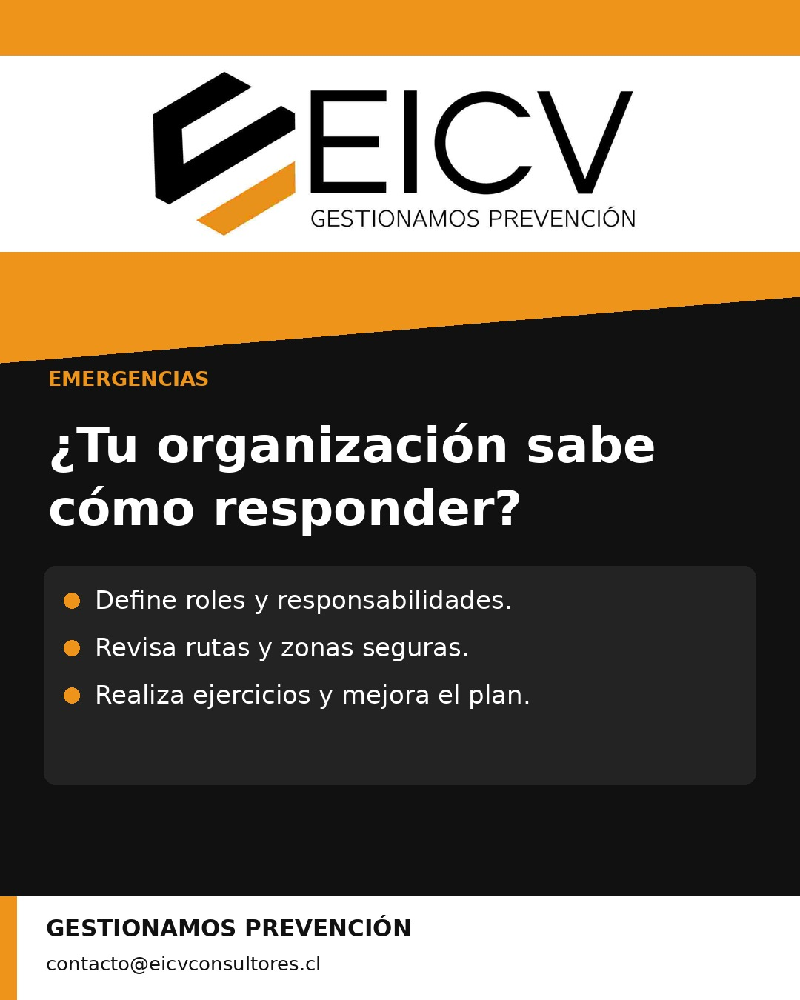
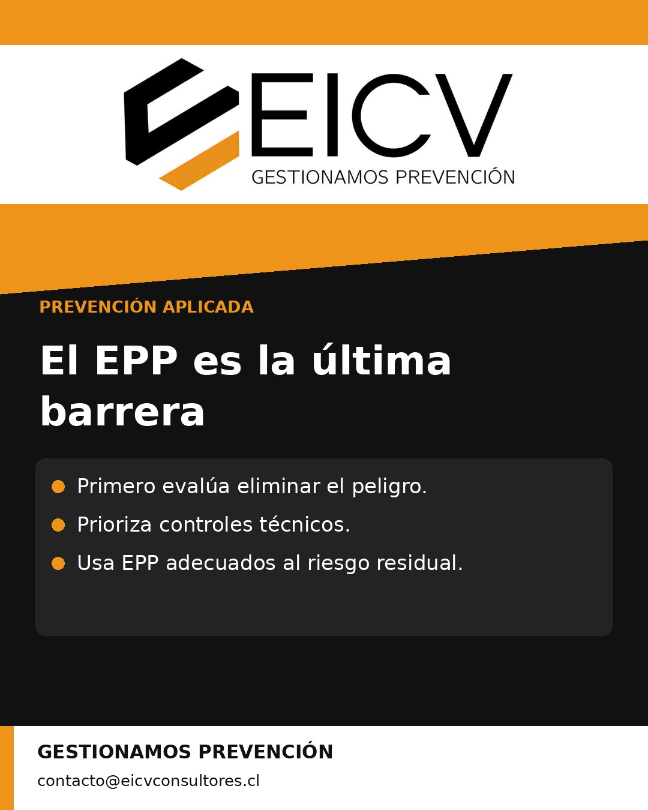
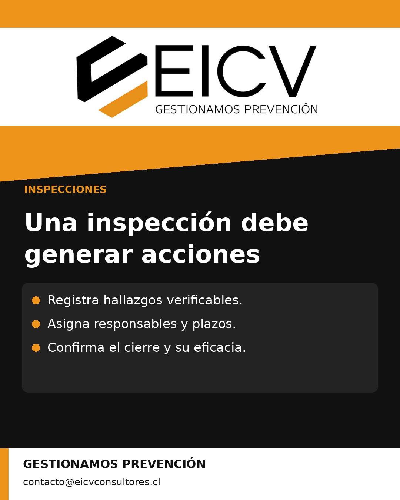
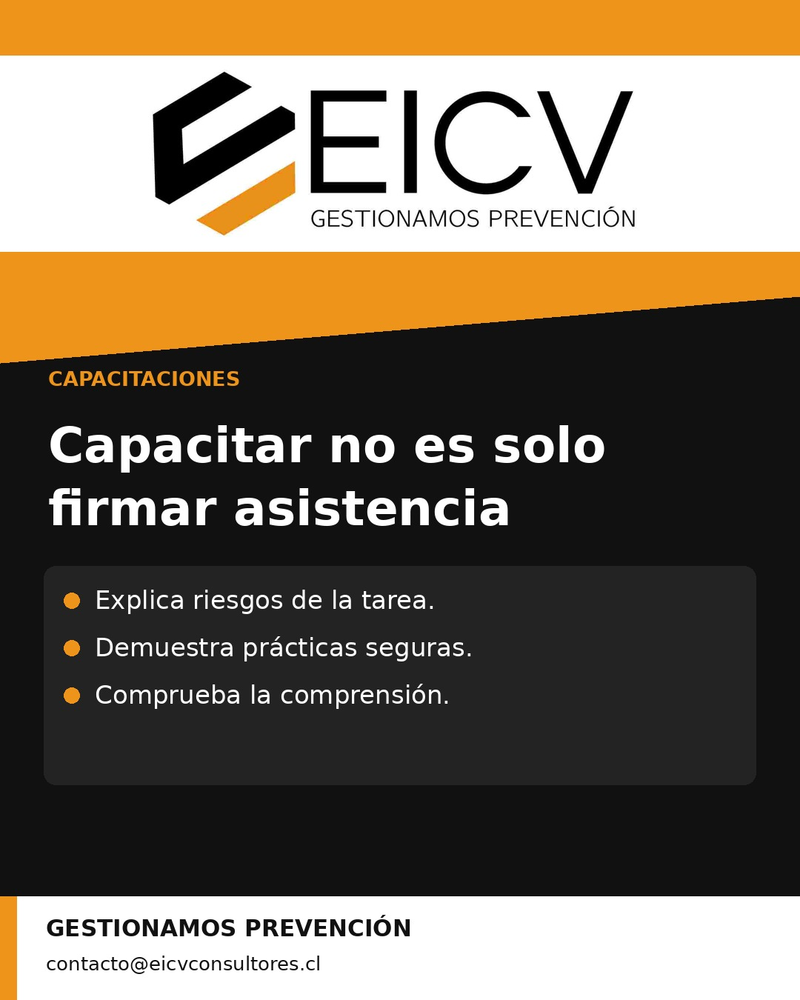
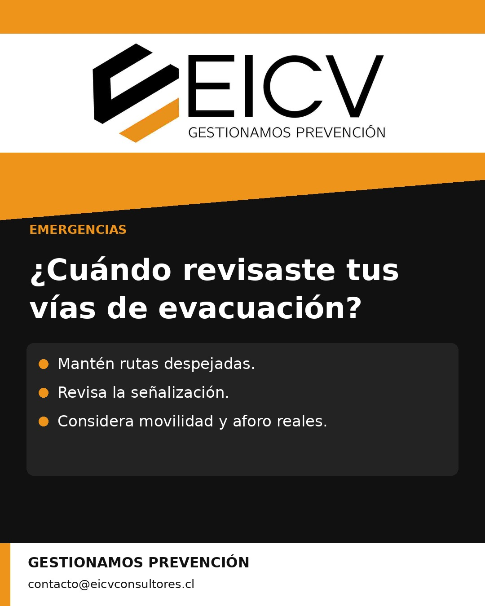
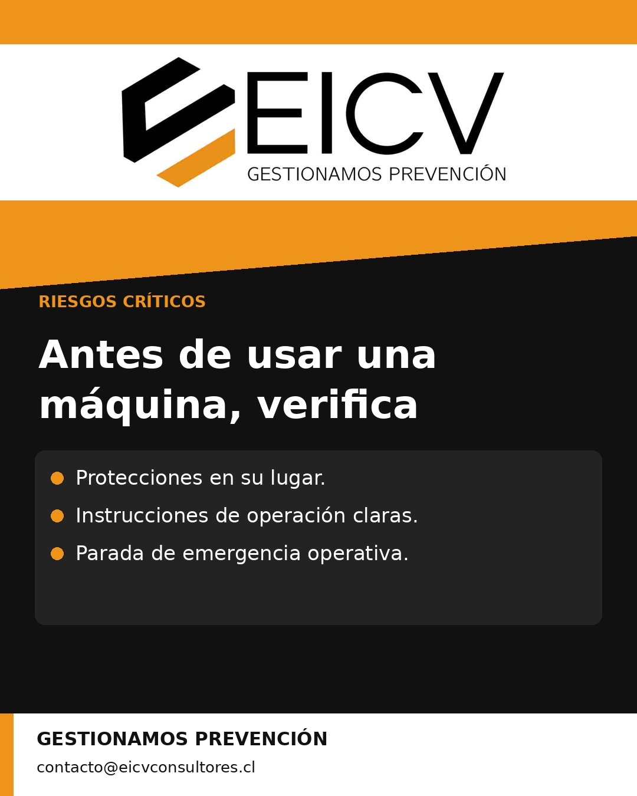
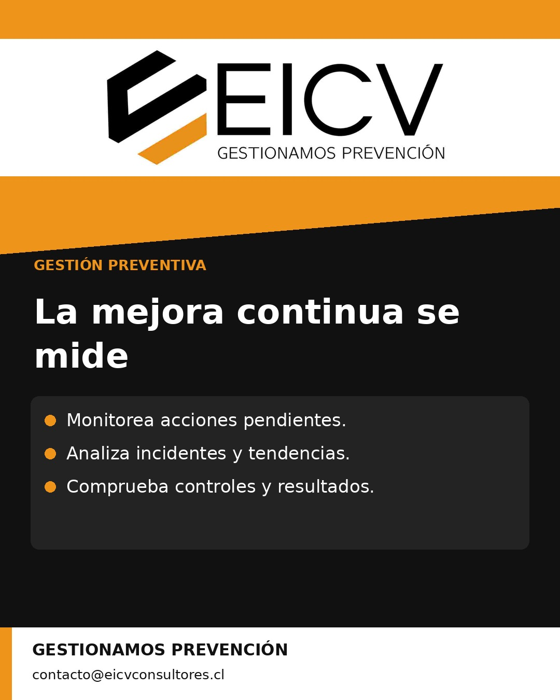
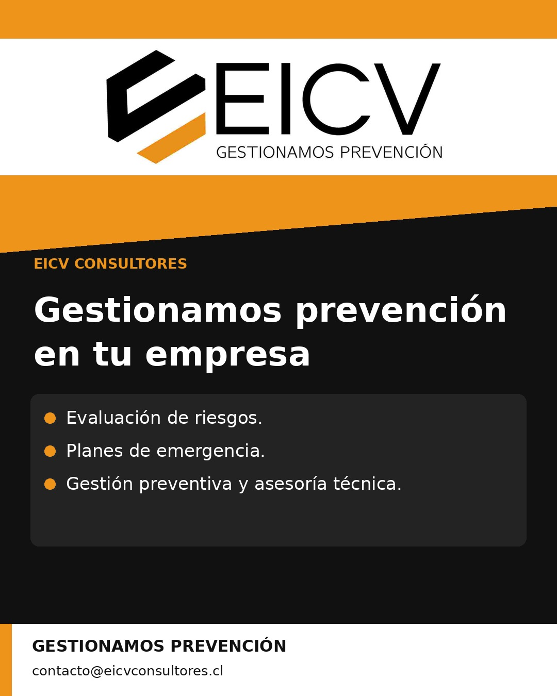

# EICV · Publicaciones de Instagram

Publicador de las 12 piezas aprobadas para **@eicvconsultores**.
Logo oficial negro/naranja y contacto **contacto@eicvconsultores.cl**.

## Configuración

1. Hospedar la carpeta `docs` en GitHub Pages (rama `main`, carpeta `/docs`).
2. Crear el secreto de Actions `IG_ACCESS_TOKEN` con el token de la cuenta EICV. Nunca pegarlo en código, incidencias, commits o chats.
3. Crear la variable `PUBLIC_BASE_URL` con la dirección de Pages, sin `/posts` al final.
4. Ejecutar Actions → **Publicación automática EICV** → Run workflow → **validar**.
5. Tras comprobar la conexión y las imágenes, establecer `PUBLICAR_ACTIVO=true` para habilitar el calendario.

El ID de cuenta esperado es `17841457244538530`; se comprueba que el usuario autenticado sea `eicvconsultores` antes de publicar. `IG_API_BASE` permite fijar `https://graph.instagram.com` o `https://graph.facebook.com`; el modo `auto` comprueba ambos dominios oficiales mediante una consulta de lectura para determinar cuál acepta el token. `IG_API_VERSION` es configurable y usa `v26.0` inicialmente. La primera validación debe confirmar que la combinación de token y API funciona.

## Calendario

Todos los días, **10:00 America/Santiago**. GitHub puede retrasar la ejecución. Las 12 piezas se usan una vez y luego se detiene el envío: no se generan contenidos nuevos ni se repiten los anteriores.

El publicador actual envía imágenes al feed. Las 12 piezas incorporan la línea visual fotográfica de EICV, con chalecos verde fluorescente; cada texto combina consejos prácticos y una invitación a contactar a EICV para abordar brechas preventivas. Reels e historias requieren piezas y soporte específicos, aún no activados.

La ejecución manual usa **validar** por defecto y no crea publicaciones. El modo **publicar** envía la siguiente pieza, incluso si el calendario está pausado. `PUBLICAR_ACTIVO` controla solo las ejecuciones programadas.

## Registro y recuperación

`estado.json` conserva el siguiente índice, los identificadores confirmados y cualquier contenedor pendiente. El estado se guarda en el repositorio antes y después de enviar. Si se pierde la confirmación durante un envío, queda en fase `publishing` y se bloquea cualquier reintento automático para evitar una publicación duplicada.

Ante ese bloqueo, revisar primero el perfil y el contenedor en Meta. Si la publicación existe, registrar su identificador y avanzar el índice. Si se confirma que no se publicó y que no puede terminar después, retirar el pendiente mediante un cambio revisado. No borrar el registro sin esa comprobación.

Los tokens pueden ser revocados o perder permisos. Las fallas quedan registradas en Actions sin imprimir la credencial ni la respuesta completa de la API. Si falla la comprobación de cuenta, no se publica. El repositorio no contiene ninguna credencial.

## Campaña fotográfica · 12 publicaciones

Frecuencia diaria a las **10:00 de Chile**. Todas las imágenes son recreaciones visuales. Cada publicación incluye consejos prácticos, una invitación a contar con EICV y sus datos de contacto.

| Publicaciones | | |
|---|---|---|
| **01. Seguridad que se transforma en gestión**  | **02. Una matriz archivada no controla los riesgos**  | **03. ¿Tu organización sabe cómo responder?**  |
| **04. Tres hábitos para trabajar más seguro**  | **05. El EPP es la última barrera**  | **06. Cada empresa tiene riesgos distintos**  |
| **07. Una inspección debe generar acciones**  | **08. Capacitar no es solo firmar asistencia**  | **09. ¿Cuándo revisaste tus vías de evacuación?**  |
| **10. Antes de usar una máquina, verifica**  | **11. La mejora continua se mide**  | **12. Gestionamos prevención en tu empresa**  |
